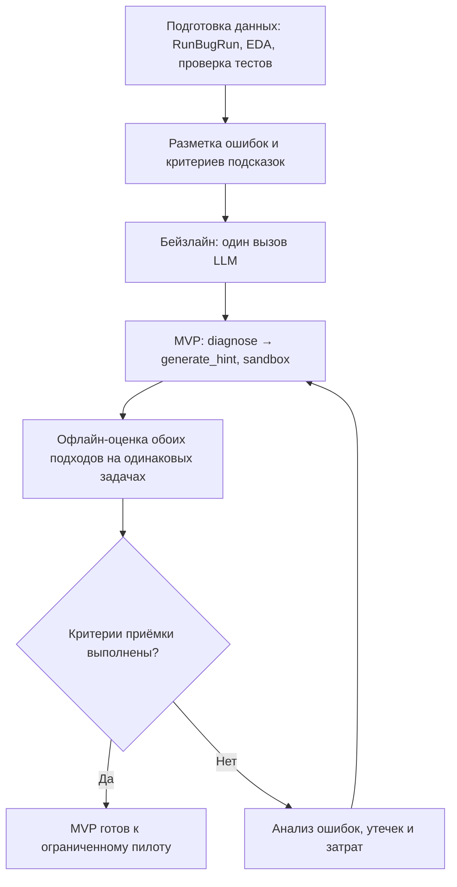

# Дизайн ML системы - CodeMentor, MVP, v1

> Документ построен по шаблону [ML System Design Doc (Reliable ML)](https://github.com/IrinaGoloshchapova/ml_system_design_doc_ru/blob/main/ML_System_Design_Doc_Template.md).
>
> **Примечание о характере проекта.** Данный проект реализуется в рамках обучающего курса "Введение в LLM"
>
> **Ментор** - система, с которой общается человек.
> **Студент** - пользователь системы, тот, кто отправляет запросы системе.

## 1. Цели и предпосылки
### 1.1. Зачем идем в разработку продукта?
* **Проблема:** Преподавателей и ассистентов на курсе зачастую мало, а автопроверка отвечает только «Wrong answer on test 7». Обычные LLM-чаты выдают готовый код, и студент не учится.
**Цель продукта** - Разработать интеллектуального наставника по программированию, который помогает студентам находить и исправлять ошибки в собственных решениях с помощью последовательных подсказок, не предоставляя готовый исправленный код. При самостоятельном решении задач по программированию студент может испытывать трудности с определением причины неверного результата.
* **Что даёт ML:** LLM позволит решать любые задачи предлагаемые студентом в формате Наставника. Существующие ИИ-ассистенты способны предлагать готовые исправления, однако это не всегда способствует самостоятельному освоению навыков отладки и пониманию алгоритмов.
* **Успех итерации:**  Прототип, позволяющий провести воспроизводимую оценку качества автоматического выявления ошибок и генерации образовательных подсказок.

### 1.2. Бизнес-требования и ограничения
* **Требования:**
    1. Пользователь может отправить условие задачи и исходный код решения на Python. Система должна иметь возможность использовать доступные тесты для проверки решения в изолированной среде.
    2. Система проверяет решение на тестах, определяет результат выполнения и при обнаружении ошибки формирует описание её предполагаемой причины.
    3. Система предоставляет подсказки трёх уровней конкретности: от общего направления поиска ошибки до более точного указания на проблемный участок логики.
    4. Подсказки должны помогать студенту самостоятельно находить и исправлять ошибки, не раскрывая готовое исправленное решение в стандартном режиме наставничества.
    5. Пользователь может отправить исправленную версию кода для повторной проверки. Система учитывает историю попыток и ранее предоставленные подсказки в рамках текущей сессии.
    6. Качество диагностики и подсказок должно поддаваться воспроизводимой оценке и сравнению с простым бейзлайном.

* **Ограничения:**
    * Ограниченные вычислительные ресурсы и бюджет учебного проекта.
    * Ограниченный объём ручной разметки для оценки качества.
    * Первая итерация ограничивается задачами на Python, для которых доступны условия и пригодные для выполнения тесты.
    * В первой итерации используются готовые LLM без дообучения весов. Полноценная персонализация, автоматический подбор задач и проверка долгосрочного образовательного эффекта не входят в обязательный объём Первой итерации.

### 1.3 Что входит в скоуп итерации

* **Входит в MVP**
    * Поддержка одного языка программирования: Python.
    * Работа с условием задачи, исходным кодом и тестами.
    * Классификация типичных ошибок студента.
    * Генерация подсказок с несколькими уровнями конкретности.
    * Базовая проверка подсказок на утечку готового решения.
    * Сохранение истории взаимодействий и категорий ошибок.
    * Офлайн-оценка качества на фиксированном наборе задач.
* **Не входит в MVP:**
    * Поддержка нескольких языков программирования.
    * Полноценная интеграция с LMS и образовательными платформами.
    * Обучение собственной большой языковой модели с нуля.
    * Сложная система пользовательских профилей и долгосрочной адаптации учебной программы.
    * Масштабирование на промышленную нагрузку.
    * Гарантия полного отсутствия ошибочных подсказок.

### 1.4. Предпосылки решения
1. Для значительной части учебных задач доступны эталонные тесты, позволяющие определить, является ли решение корректным.
2. Существуют открытые наборы программ с ошибками и соответствующими тестами, которые можно использовать для первичной оценки.
3. LLM способна извлекать полезную информацию из условия задачи, кода и результатов тестирования.
4. Успешное прохождение тестов является свидетельством корректности решения, но само по себе не доказывает, что студент понял причину ошибки.

## Методология
### 2.1. Постановка задачи
Code Mentor - интерактивная система помощи при отладке учебных программ. ML-компонент решает задачу условной генерации текста: на основании условия задачи, исходного кода, результатов объективной проверки и требуемого уровня конкретности генерирует подсказку, **не раскрывая готовое решение**. Дообучение моделей проводится **не будет**.

Определение того, проходит ли код студента тесты, не является прогнозом LLM: код запускается в изолированной среде (Judge0), а приложение агрегирует статусы и результаты тестов. Переходы между шагами заранее заданы, роутинг определяется программными правилами, а не решением LLM (AI Workflow). LLM-as-a-Judge используется офлайн для оценки качества подсказок.

Одна операция генерации - одна подсказка к одной попытке решения одной задачи на выбранном уровне конкретности подсказки. Система получает задачу и пользовательскую попытку -> после проверки кода, если есть ошибка, формирует подсказку. После следующей попытки цикл повторяется, при успехе система прекращает генерацию подсказок по данной задаче.

| Компонент / операция | Входные данные | Выход | Метод и ограничения |
| --- | --- | --- | --- |
| Sandbox | Код студента, Python runtime, тесты, лимиты ресурсов | `ExecutionResult`: число пройденных тестов, статус, безопасная сводка ошибок | Judge0 / аналог; изоляция и детерминированное сопоставление вывода с ожидаемым |
| Роутинг | `ExecutionResult`, состояние сессии | Следующий узел workflow | Программные правила: `accepted` -> завершение; ошибки решения -> диагностика/подсказка; `internal_error` -> техническая ошибка без учебного вывода |
| LLM*: диагностика | Условие, код, сводка тестов | Структура `Diagnosis` с предполагаемой ошибкой и подтверждающими свидетельствами | Вызов готовой LLM; ответ проверяется по схеме Pydantic; возможны ошибки диагностики |
| LLM*: подсказка | Условие, код, сводка тестов, `Diagnosis`, уровень подсказки {1,2,3} | Текст подсказки | Готовая LLM без выдачи исправленного кода; уровень задаёт приложение |
| Оффлайн оценка | Подсказки, уровень, эталонная экспертная разметка | Метрики(Leakage Rate, Hint Level Compliance), контроль корректности подсказок | LLM-as-a-Judge + проверка его качества на вручную(?) размеченной выборке |

>\* Одна и та же LLM. Также на данном этапе приянто решение использовать всё ту же LLM для самопроверки: Модель будет сама себе делать запрос с вопросом "Является ли подсказка корректной? Соответствует ли она уровню?

Уровни подсказок:
* **Уровень 1** - общее направление поиска ошибки;
* **Уровень 2** - более конкретная область или логика, которую стоит перепроверить;
* **Уровень 3** - подробное объяснение причины, не содержащее готовый исправленный код.


**Метрики** .Основные офлайн-метрики:

Leakage Rate - доля подсказок, раскрывающих решение. минимизировать
```math
LeakageRate_l =
\frac{\text{Количество подсказок с утечкой }l}
{\text{Количество всех подсказок уровня }l}
```
>$LeakageRate_l → min$

Hint Level Compliance - доля подсказок, соответствующих заданному уровню. максимизировать
```math
Compliance_l =
\frac{\text{Подсказки, соответствующие уровню }l}
{\text{Все подсказки уровня }l}
```
>$Compliance_l → max$

### 2.2 Блок схема работы Ментора
**Блок схема разработки и исследования**


**Блок-схема Пользовательского опыта**
```mermaid
flowchart TD
    A["Код и условие задачи"] --> B["Запуск тестов в sandbox"]
    B --> C{"Результат тестирования"}

    C -->|Все тесты пройдены| K["Задача решена"]
    C -->|Есть ошибки| D["LLM: диагностика ошибки"]

    D --> E["Генерация подсказки"]
    E --> F["Проверка качества и утечки"]
    F --> G{"Подсказка безопасна?"}

    G -->|Нет| E
    G -->|Да| H["Подсказка студенту"]

    H --> I["Студент исправляет код"]
    I --> J["Повторная отправка решения"]
    J --> B

    K --> L["История ошибок и краткий отчёт"]
