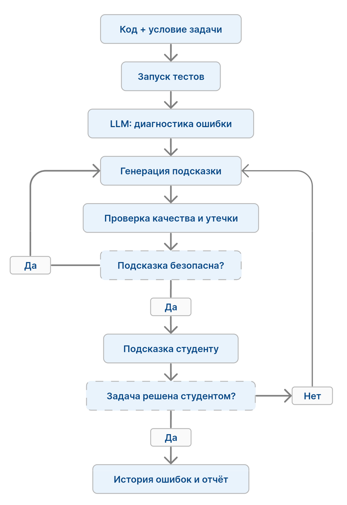

## Дизайн ML системы - CodeMentor, MVP, v1

> Документ построен по шаблону [ML System Design Doc (Reliable ML)](https://github.com/IrinaGoloshchapova/ml_system_design_doc_ru/blob/main/ML_System_Design_Doc_Template.md).
>
> **Примечание о характере проекта.** Данный проект реализуется в рамках обучающего курса "Введение в LLM", легенда об использовании в образовательном процессе не имеет ничего общего с действительностью.
>
> **Ментор** - система, с которой общается человек.
> **Студент** - пользователь системы, тот, кто отправляет запросы системе.

### 1. Цели и предпосылки
#### 1.1. Зачем идем в разработку продукта?
* **Проблема:** Преподавателей и ассистентов на курсе зачастую мало, а автопроверка отвечает только «Wrong answer on test 7». Обычные LLM-чаты выдают готовый код, и студент не учится.
**Цель продукта** - Разработать интеллектуального наставника по программированию, который помогает студентам находить и исправлять ошибки в собственных решениях с помощью последовательных подсказок, не предоставляя готовый исправленный код. При самостоятельном решении задач по программированию студент может испытывать трудности с определением причины неверного результата.
* **Что даёт ML:** LLM позволит решать любые задачи предлагаемые студентом в формате Наставника. Существующие ИИ-ассистенты способны предлагать готовые исправления, однако это не всегда способствует самостоятельному освоению навыков отладки и пониманию алгоритмов.
* **Успех итерации:**  Прототип, позволяющий провести воспроизводимую оценку качества автоматического выявления ошибок и генерации образовательных подсказок.

#### 1.2. Бизнес-требования и ограничения
* **Требования:**
    1. Пользователь может отправить условие задачи, исходный код и доступные результаты выполнения тестов.
    2. Система анализирует решение и возвращает описание предполагаемой ошибки.
    3. Система предоставляет последовательные уровни подсказок — от общего направления поиска до более конкретного указания на проблемный участок логики.
    4. Система не должна выдавать готовое исправленное решение в стандартном режиме наставничества.

* **Ограничения:**
    * Ограниченные вычислительные ресурсы и бюджет учебного проекта.
    * Ограниченный объём ручной разметки для оценки качества. Трудность в определении формальной успешности итерации.

#### 1.3 Что входит в скоуп итерации

* **Входит в MVP**
    * Поддержка одного языка программирования: Python.
    * Работа с условием задачи, исходным кодом и тестами.
    * Классификация типичных ошибок студента.
    * Генерация подсказок с несколькими уровнями конкретности.
    * Базовая проверка подсказок на утечку готового решения.
    * Сохранение истории взаимодействий и категорий ошибок.
    * Офлайн-оценка качества на фиксированном наборе задач.
* **Не входит в MVP:**
    * Поддержка нескольких языков программирования.
    * Полноценная интеграция с LMS и образовательными платформами.
    * Обучение собственной большой языковой модели с нуля.
    * Сложная система пользовательских профилей и долгосрочной адаптации учебной программы.
    * Масштабирование на промышленную нагрузку.
    * Гарантия полного отсутствия ошибочных подсказок.

#### 1.4. Предпосылки решения
1. Для значительной части учебных задач доступны эталонные тесты, позволяющие определить, является ли решение корректным.
2. Существуют открытые наборы программ с ошибками и соответствующими тестами, которые можно использовать для первичной оценки.
3. LLM способна извлекать полезную информацию из условия задачи, кода и результатов тестирования.
4. Успешное прохождение тестов является свидетельством корректности решения, но само по себе не доказывает, что студент понял причину ошибки.

#### 1.5 Блок схема работы Ментора

